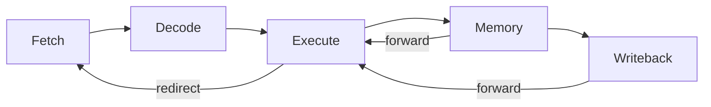

# RV32I core specification

The core starts from address zero after a synchronous, active-low reset. It executes RV32I integer arithmetic, branches, jumps, and little-endian byte, halfword, and word loads and stores. FENCE retires as a no-op on the in-order memory interface. Both cores implement machine-mode synchronous traps and MRET. The legacy halted output is held low.

The five stages are instruction fetch, decode, execute, memory, and writeback. Execute chooses the newest available operand from EX/MEM or MEM/WB. A load immediately followed by a consumer inserts one bubble when memory responds without a wait. Execute resolves branches and jumps, squashing the two younger instruction slots when control changes. A taken branch has a two-cycle penalty when memory responds immediately.

Both memory ports use request valid and response ready. A transfer occurs on a rising edge with both high. Instruction memory returns a full word for the requested address. The core can withdraw a speculative request when it redirects, including on trap entry. Data memory returns the aligned containing word for loads and accepts byte strobes for stores. While waiting for data memory, the core holds the outstanding data request and backpressures the younger stages. Memory is external to the core.

The retirement port emits at most one event per cycle, with the PC, instruction, and architectural register write, if any. Register x0 always reads as zero and has no architectural write event. Stores update memory in MEM with all earlier instructions in order. A faulting instruction has no retirement event and does not write a general-purpose register or issue a data-memory request. The pipeline waits for an older outstanding memory transaction before taking the trap, then squashes both younger slots and fetches from `mtvec`.

## Machine-mode traps

`mtvec` implements Direct mode and resets to zero. Firmware should install a word-aligned handler before it can encounter a trap. Trap entry saves the faulting instruction's PC in `mepc`, saves the cause and associated value, copies MIE to MPIE, and clears MIE. MRET jumps to `mepc`, restores MIE from MPIE, and sets MPIE. The core executes only in machine mode and its MPP field reads as Machine.

| Exception | `mcause` | `mtval` |
| --- | --- | --- |
| Misaligned taken branch or jump target | 0 | Target address |
| Illegal instruction or CSR access | 2 | Instruction word |
| EBREAK | 3 | Instruction address |
| Misaligned load | 4 | Data address |
| Misaligned store | 6 | Data address |
| ECALL in machine mode | 11 | Zero |

The six CSR instructions access the implemented machine CSRs. `mstatus` implements MIE and MPIE, `mscratch`, `mepc`, `mcause`, and `mtval` hold machine state, and `misa` reports RV32I. `mie`, `mip`, `mstatush`, and the machine identification registers read zero. Interrupt delivery, additional privilege modes, vectored entry, and memory-bus access faults are outside this interface. The regression harness ends a program when its reserved store of x0 to byte address 1020 retires.

