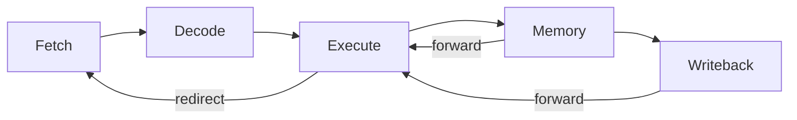

# RV32I core specification

The core starts from address zero after a synchronous, active-low reset. It executes RV32I integer arithmetic, branches, jumps, and little-endian byte, halfword, and word loads and stores. FENCE retires as a no-op on the in-order memory interface. ECALL, EBREAK, illegal instructions, and misaligned accesses halt the core in program order. Privileged state and trap handlers are outside this design.

The five stages are instruction fetch, decode, execute, memory, and writeback. Execute chooses the newest available operand from EX/MEM or MEM/WB. A load immediately followed by a consumer inserts one bubble when memory responds without a wait. Execute resolves branches and jumps, squashing the two younger instruction slots when control changes. A taken branch has a two-cycle penalty when memory responds immediately.

Both memory ports use request valid and response ready. A transfer occurs on a rising edge with both high. Instruction memory returns a full word for the requested address. The core can withdraw a speculative request when it redirects or halts. Data memory returns the aligned containing word for loads and accepts byte strobes for stores. While waiting for data memory, the core holds the outstanding data request and backpressures the younger stages. Memory is external to the core.

The retirement port emits at most one event per cycle, with the PC, instruction, and architectural register write, if any. Register x0 always reads as zero and has no architectural write event. Stores update memory in MEM with all earlier instructions in order.

